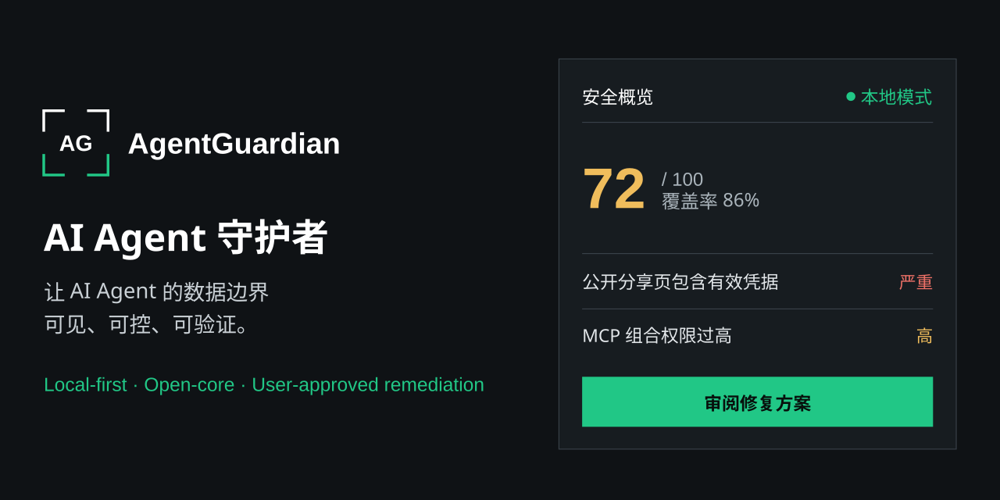

# AgentGuardian

AgentGuardian 是一款面向 Windows 的本地 AI 配置安全审计工具，帮助 AI 用户和 AI 创作者在使用 Codex、MCP 及其他本地 AI 工具前，先检查配置中可能暴露的凭据、个人信息、危险权限和公开分享风险。

很多风险并不是出现在“某个系统被攻破”之后，而是藏在一个配置文件、一段 MCP 设置或一次公开分享里。AgentGuardian 会在你明确选择的范围内进行本地、只读检查，给出脱敏后的证据和人工处理建议；真正的删除、撤销、轮换和权限调整仍由你在原应用中确认。

## 目录

- [一、这个项目是什么？](#一这个项目是什么)
- [二、先看效果](#二先看效果)
- [三、适合谁用？](#三适合谁用)
- [四、你会得到什么？](#四你会得到什么)
- [五、它能帮你解决什么问题？](#五它能帮你解决什么问题)
- [六、安装与快速开始](#六安装与快速开始)
- [七、如何使用？](#七如何使用)
- [八、项目工作流程](#八项目工作流程)
- [九、项目目录结构](#九项目目录结构)
- [十、注意事项与常见问题](#十注意事项与常见问题)
- [十一、版本说明](#十一版本说明)
- [十二、相关项目](#十二相关项目)
- [十三、关于作者](#十三关于作者)
- [十四、继续探索](#十四继续探索)

## 一、这个项目是什么？

它是一款可以直接打开的 Windows 桌面应用，也可以配合独立的 Codex Skill 和本地 MCP 使用。

- **桌面应用**：选择本地文件夹，查看风险发现、处理步骤和 HTML/JSON 报告。
- **Codex Skill**：一套让 AI 按照固定安全流程完成审计的操作指南，需要配合支持本地 MCP 的主机使用。
- **本地 MCP**：运行在自己电脑上的接口，让 Codex 或其他支持 MCP 的工具调用同一个本地审计核心。

项目会读取你明确选择的本地范围，按固定上限进行检查，并在读取或验证数据前要求人工确认。默认不调用 OpenAI 或其他服务商 API，也不会把审计文件自动上传到云端。

当前版本只支持个人、非受监管的配置数据。它不是企业安全平台，也不能证明某个账号、MCP 服务、浏览器或系统“绝对安全”。

## 二、先看效果


上图是仓库中的合成演示封面，用来说明项目的视觉方向，不是某位用户的真实审计结果。

一次典型使用是：

1. 你选择一个本地 AI 配置目录，例如 `.codex`。
2. 你确认数据属于个人、非受监管范围，并同意当前显示的审计范围。
3. AgentGuardian 检查支持的配置文件，显示规则、风险域、严重性和已掩码证据。
4. 你点击某一条风险后，可以看到所属应用、来源文件、短范围名称和处理位置。
5. 你回到原应用处理后，重新审计同一个范围，再保存新报告。

## 三、适合谁用？

### 特别适合

- 经常使用 Codex、MCP 或其他本地 AI 工具的个人创作者。
- 想在分享配置、安装插件或启用本地工具前，先做一次快速自查的人。
- 需要把风险线索、脱敏证据和人工处理步骤整理成报告的人。
- 希望在同一台 Windows 电脑上检查多个本地 AI 配置目录的人。

### 不适合

- 需要审计医疗、金融、身份、生物识别、法律特权、客户数据、国家秘密或其他高敏感真实数据的场景。
- 需要云端集中管理、持续监控、自动封禁或企业合规认证的场景。
- 希望工具自动删除文件、自动撤销所有密钥或自动判断某个服务是否可信的场景。
- 没有 Windows 11 x64，且不愿使用 Python 3.12 以上版本进行源码运行的场景。

## 四、你会得到什么？

完成一次审计后，你可以得到：

- 桌面界面中的风险列表和覆盖状态。
- 每条风险的规则、风险域、严重性、已掩码证据、所属应用线索、来源文件和处理位置。
- 可在界面中查看的风险处理方案，包括凭据、个人信息、端点、MCP、权限和复审步骤。
- 可保存到本地的 HTML 或 JSON 审计报告。
- 可选的风险处置记录，例如误报、接受风险、撤销处置，以及有限的固定修复和回滚记录。

报告和界面会尽量隐藏完整路径和原始敏感匹配内容。对于自选目录，工具可能无法仅凭目录名称确认具体应用，此时会明确提示你回到来源文件所属的原应用中核对。

## 五、它能帮你解决什么问题？

以前你可能需要手动翻找多个配置文件，猜测某个邮箱、手机号、密钥或 MCP 权限到底来自哪个程序。AgentGuardian 会把检查范围、来源文件和脱敏证据集中展示，并把“应该在哪里处理”写在每条风险下面。

它可以减少重复查找和复制敏感内容的需要，但不会替你决定风险是否可以接受。你仍然需要确认：这段数据是否真的存在、哪个应用在使用它、是否有业务保留必要，以及处理后是否已经重新审计。

## 六、安装与快速开始

### 推荐方式：Windows 安装包

1. 打开仓库的 [Releases 页面](https://github.com/yangjing6213-dev/AgentGuardian/releases)。
2. 下载与 SHA-256 校验值同时提供的 Windows x64 安装包。
3. Windows 可能显示“未知发布者”或 SmartScreen 提示，因为当前预览安装包未签名。只有在确认来源和校验值后再运行。
4. 安装时按需选择桌面应用、Codex Skill、本地 MCP 和桌面快捷方式。
5. 安装完成后打开 AgentGuardian，看到“审计范围”页面即可开始。

如果 Releases 页面没有可用的安装包，说明运行时尚未作为正式发行包提供，请使用下面的源码方式，或等待经过授权的预览包。

### 源码方式：Windows PowerShell

需要 Windows 11 x64、Python 3.12 或更高版本。建议在项目文件夹中执行：

```powershell
py -3.12 -m venv .venv
.\.venv\Scripts\python -m pip install -e .
.\.venv\Scripts\python -m agentguardian
```

看到 AgentGuardian 桌面窗口，说明启动成功。开发者还可以按 [CONTRIBUTING.md](CONTRIBUTING.md) 执行测试和安全检查。

### 第一次使用示例

你可以先创建一个只含合成数据的测试目录，不要直接拿真实密钥或客户资料试用：

```powershell
New-Item -ItemType Directory .\agentguardian-demo -Force | Out-Null
@'
{"contact":"demo@example.com"}
'@ | Set-Content .\agentguardian-demo\demo.json -Encoding UTF8
```

打开应用后：

1. 在“审计范围”中点击“选择文件夹”，选择 `agentguardian-demo`。
2. 勾选个人、非受监管数据确认，以及当前显示范围确认。
3. 点击“开始审计”。
4. 在“风险发现”中选择一条结果，查看下方的“风险详情与人工处理步骤”。
5. 处理完成后重新审计，并在“审计报告”中保存 HTML 或 JSON 报告。

下载文件不等于完成安装；安装完成也不等于 Codex 已经启用 MCP。Skill 只有在当前主机能看到 `prepare_audit` 和 `run_prepared_audit` 两个本地工具时，才会继续审计流程。

## 七、如何使用？

### 日常审计

1. **选择范围**：只选择你确实需要检查的文件夹或文件。
2. **确认边界**：确认数据属于个人、非受监管配置，并核对界面显示的范围。
3. **开始审计**：审计过程只读取选定范围，按照固定文件数量、大小和发现数量上限运行。
4. **查看风险**：在“风险发现”中按严重性、风险域或处置状态筛选，然后点击某一条风险。
5. **定位处理**：详情会说明可能对应的应用、来源文件、短范围和处理位置；完整本地路径不会直接显示。
6. **选择处置**：确认误报时标记误报；确认风险但暂时允许保留时记录接受风险。处置记录不会改写原始文件。
7. **重新审计**：任何人工修改完成后，对相同范围重新执行审计，再保存新的报告。

### 其他页面

- **审计报告**：查看 HTML 或 JSON 报告，选择基线报告进行结果比较，并保存当前报告。
- **解决方案**：按“复核事实 → 处理凭据或个人信息 → 核对端点和权限 → 复审”的顺序查看建议。
- **关于作者**：查看作者介绍、联系方式和项目背景。
- **界面语言**：在左侧切换简体中文和 English；选择会保存在本机。

### 与 Codex Skill / MCP 配合

Skill 和 Windows 运行时是两层独立内容。Skill 负责检查工具、收集同意和调用已配置的本地 MCP；`AgentGuardianMcp.exe --stdio-mcp` 才是本地 MCP 入口，窗口程序 `AgentGuardian.exe` 不能替代它。缺少本地工具时，Skill 会停止并提示配置问题，不会用其他方式绕过 MCP。

## 八、项目工作流程

```text
选择范围
  → 查看数据边界和范围
  → 明确同意
  → 本地只读审计
  → 查看风险与脱敏证据
  → 回到原应用人工处理
  → 对相同范围重新审计
  → 保存报告并复核
```

项目负责发现线索、限制读取范围、遮盖证据并生成报告；用户负责判断风险是否真实、是否需要保留、在哪里修改，以及处理后是否达到预期。

## 九、项目目录结构

```text
README.md                         面向使用者的中文说明
src/agentguardian/                桌面应用、审计核心和本地 MCP 实现
src/agentguardian/assets/         图标、翻译文件和作者海报
rules/                            默认审计规则
skills/agentguardian/             可独立安装的 Codex Skill
assets/brand/                     项目标志、封面和品牌说明
packaging/windows/                Windows PyInstaller 与 Inno Setup 配置
scripts/                          构建、验证和安全检查脚本
tests/                            自动化测试
docs/                             架构、安全边界和开发记录
dist/                             本地构建后生成的安装包目录，不是源码入口
```

普通用户通常只需要使用安装包、桌面界面和“审计报告”页面，不需要修改 `src/`、`rules/` 或 `packaging/` 中的文件。

## 十、注意事项与常见问题

### Windows 显示未知发布者

**现象**：运行安装包时出现 Unknown Publisher 或 SmartScreen 提示。

**原因**：当前预览安装包未使用代码签名证书。

**处理**：核对下载来源和 SHA-256；如果无法确认来源，不要运行安装包。

### 审计后没有结果

**现象**：扫描完成但没有风险，或报告显示覆盖不完整。

**可能原因**：选择的目录没有支持的文件后缀、文件超过读取上限、目录被排除，或扫描范围本身没有匹配规则。

**处理**：查看“覆盖状态”，确认范围和文件类型，再用合成测试目录复现。没有发现不等于系统绝对安全。

### 某条风险来自哪个程序？

已知的 `.codex`、Claude、Cursor、Windsurf 和 OpenAI 配置目录会显示对应应用线索，并列出来源文件和短范围。自选目录无法可靠映射到具体应用时，界面会明确说明这一点；请按显示的来源文件回到原应用核对。

### 可以直接点击“修复”吗？

固定修复目前只覆盖允许的 OpenAI 地址配置，并会先预览、确认和备份。凭据、个人信息、MCP 权限等其他风险需要回到原应用人工处理。回滚也只适用于本次会话中仍未被改动的固定替换。

### 数据会上传吗？

文件和剪贴板审计默认在本地完成；剪贴板只在用户点击时读取一次，原文不写入报告。联网分享验证只在用户明确输入公开 URL 后执行。脱敏参数和结果可能进入已配置主机的 AI 上下文，因此仍要按数据边界使用。

### 是否可以用于商业或高敏感数据？

当前项目说明只覆盖个人、非受监管配置数据。不要用它处理医疗、金融、身份、生物识别、法律特权、客户数据、国家秘密或同等高敏感真实数据。源代码使用 Apache License 2.0，但依赖和 Windows 运行时的再分发义务仍需单独核对。

## 十一、版本说明

- **源码版本**：`0.3.0a1`，见 [pyproject.toml](pyproject.toml)。
- **当前通道**：Windows 11 x64 的 Integrations Preview，安装包版本为 `0.3.0-preview.1`。
- **已完成**：桌面 GUI、中文/英文切换、风险详情、解决方案页、HTML/JSON 报告、独立 Skill、本地 STDIO MCP 和本地安装验证。
- **尚未宣称**：生产安全、企业合规认证、干净电脑的全面安装保证、完整许可证审查或已签名发行版。
- **更新记录**：见 [CHANGELOG.md](CHANGELOG.md)。

### 公开预览的版本边界

为了让普通用户和协作者看到同一份事实，仓库保留以下英文状态标识：

- `0.3 Integrations Preview is the active development track`；`0.2.0-beta.1` 是冻结的历史版本，构建时使用 **frozen exact SHA** 进行边界校验。
- 当前下载渠道是 **unsigned Public Preview**，只面向 Windows 11 x64 的个人、非受监管配置数据（personal non-regulated configuration data）；high-sensitivity real data is out of scope。
- 预览状态仍记录为 `INTEGRATIONS-PREVIEW-NOT-READY` 和 `NO-GO`，这表示它不应被当作 production-safety 承诺，也不是 enterprise control-plane。
- 固定下载入口：[Windows x64 安装包](https://github.com/yangjing6213-dev/AgentGuardian/releases/latest/download/AgentGuardian-Setup-Windows-x64.exe)。安装包未签名，运行前请核对 [SHA256SUMS](https://github.com/yangjing6213-dev/AgentGuardian/releases/latest/download/SHA256SUMS)。
- 发布清单包含 `AgentGuardian-0.3.0-preview.1-windows-x64.zip`、`AgentGuardian-Setup-0.3.0-preview.1-x64.exe`、`AgentGuardian-Setup-Windows-x64.exe`、`AgentGuardian-Skill-0.2.0.zip`、`DOWNLOAD-METADATA.json`、`LICENSE`、`SHA256SUMS` 和 `THIRD_PARTY_NOTICES.md`。其中 Skill payload 与桌面程序分开管理。
- `AgentGuardianMcp.exe` 只提供本地 STDIO MCP 入口；安装程序不会静默下载或启用 Provider API（does not silently download or enable a Provider API）。
- OpenAI Provider local adaptation, detection, and manual guidance only. The runtime must not call OpenAI or another provider API by default.
- 源码运行需要 Python 版本 3.12 或更高；历史 Windows MVP 文档属于 older Windows MVP reports are historical planning or evidence snapshots。
- 当前下载形态是 traditional unsigned offline EXE installer；在公开发行门禁完成前，No installer candidate has passed the required gates。

## 十二、相关项目

无。当前仓库已经包含桌面应用、Skill、本地 MCP、规则和验证脚本；使用前先理解本项目自身的数据边界更重要。

## 十三、关于作者


**Enhe（恩禾）｜产品设计师 · 一人公司实践者 · AI Builder**

用 AI 打造一人公司。

- GitHub：[yangjing6213-dev](https://github.com/yangjing6213-dev)
- X / Twitter：[Amenenhe_ai](https://x.com/Amenenhe_ai)
- 网站：[恩禾 ENHE AI](https://www.enhe-tech.com.cn/)
- 微信：Hu-Amen
- 邮箱：[amen.enhe@gmail.com](mailto:amen.enhe@gmail.com)

## 十四、继续探索

这个项目是我用 AI 搭建个人创作与工作系统时整理出的一个工具。我希望它不只是留在自己的电脑里，也能帮你解决类似的配置检查问题。

如果你也在用 AI 做内容、整理知识库、搭建工作流，或者把想法做成产品，欢迎到我的网站继续看看：

[访问恩禾 ENHE AI](https://www.enhe-tech.com.cn/)

## 许可

源代码采用 [Apache License 2.0](LICENSE)。第三方依赖、Qt 和 Windows 运行时的许可证与再分发要求，请同时阅读 [THIRD_PARTY_NOTICES.md](THIRD_PARTY_NOTICES.md)。

## English

English overview: [README.en.md](README.en.md)
